  <h1></h1>
  

  
  

I’m Adam, a final-semester **Cybersecurity Engineering** student and eJPT holder. I’m interested in how networks are secured and how people use the software built around them. My work spans penetration testing in labs, network access control, and front-end development.

## Selected work

A collaborative graduation capstone exploring how honeypot activity can be presented in a monitoring interface. The linked repository is an open development fork. [Browse the capstone fork](https://github.com/Adam-ZS/honeypot-ui)

I built a right-to-left reading app for Arabic morning and evening remembrance, with Amiri Quran typography, daily repetition counters, and a standalone offline download. [Open the app](https://adam-zs.github.io/daily-adhkar/) · [View the source](https://github.com/Adam-ZS/daily-adhkar)

## Technical focus

| Area | Tools and practice |
| --- | --- |
| **Security** | eJPT, web and network penetration testing labs, Linux |
| **Networking** | Routing, access control, and RADIUS authentication in Cisco Packet Tracer |
| **Development** | Python, C++, JavaScript, React, Git, Docker, and Arduino |

[LinkedIn](https://linkedin.com/in/adam-soman) · [Buy me a coffee](https://buymeacoffee.com/tf_a0)
