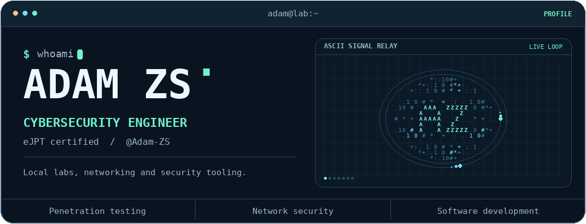
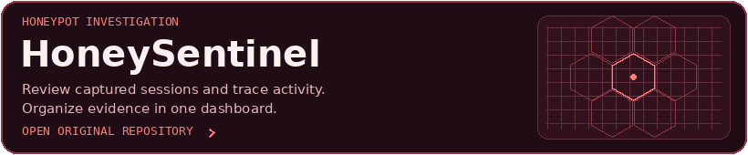
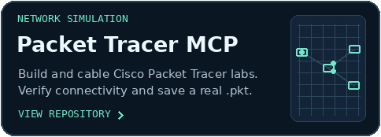
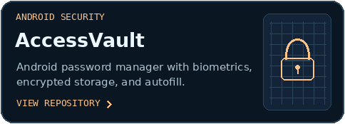
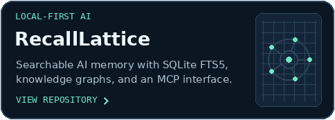
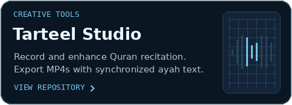
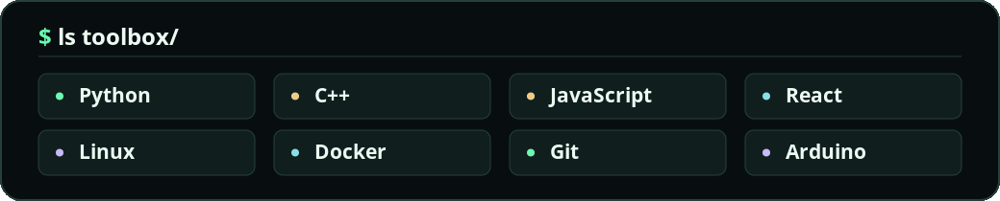

  <picture>
    <source media="(max-width: 580px) and (prefers-color-scheme: light)" srcset="assets/terminal-profile/signal-deck-mobile-light.gif">
    <source media="(max-width: 580px)" srcset="assets/terminal-profile/signal-deck-mobile-dark.gif">
    <source media="(prefers-color-scheme: light)" srcset="assets/terminal-profile/signal-deck-light.gif">
    
  </picture>
  

  <a href="https://adam-zs-portfolio.vercel.app/"><picture><source media="(prefers-color-scheme: light)" srcset="assets/terminal-profile/portfolio-loop-light.gif"></picture></a>
  <a href="https://github.com/Adam-ZS?tab=repositories"><picture><source media="(prefers-color-scheme: light)" srcset="assets/terminal-profile/repositories-loop-light.gif"></picture></a>
  <a href="https://linkedin.com/in/adam-soman"><picture><source media="(prefers-color-scheme: light)" srcset="assets/terminal-profile/linkedin-loop-light.gif"></picture></a>
  <a href="https://buymeacoffee.com/tf_a0"><picture><source media="(prefers-color-scheme: light)" srcset="assets/terminal-profile/support-loop-light.gif"></picture></a>
  

  <h2>Featured projects</h2>
  

    <a href="https://github.com/mandoof1/honeypot-ui">
      <picture>
        <source media="(max-width: 580px) and (prefers-color-scheme: light)" srcset="assets/terminal-profile/feature-honeysentinel-mobile-light.gif">
        <source media="(max-width: 580px)" srcset="assets/terminal-profile/feature-honeysentinel-mobile-dark.gif">
        <source media="(prefers-color-scheme: light)" srcset="assets/terminal-profile/feature-honeysentinel-light.gif">
        
      </picture>
    </a>
  

  

    <a href="https://github.com/Adam-ZS/packet-tracer-mcp">
      <picture>
        <source media="(prefers-color-scheme: light)" srcset="assets/terminal-profile/feature-packet-tracer-light.gif">
        
      </picture>
    </a>
    <a href="https://github.com/Adam-ZS/AccessVault">
      <picture>
        <source media="(prefers-color-scheme: light)" srcset="assets/terminal-profile/feature-accessvault-light.gif">
        
      </picture>
    </a>
  

  

    <a href="https://github.com/Adam-ZS/RecallLattice">
      <picture>
        <source media="(prefers-color-scheme: light)" srcset="assets/terminal-profile/feature-recall-light.gif">
        
      </picture>
    </a>
    <a href="https://github.com/Adam-ZS/tarteel-studio">
      <picture>
        <source media="(prefers-color-scheme: light)" srcset="assets/terminal-profile/feature-tarteel-light.gif">
        
      </picture>
    </a>
  

  <!-- contribution calendar -->
  <a href="assets/terminal-profile/activity-flight-dark.gif?raw=1">
    <picture>
      <source media="(max-width: 580px) and (prefers-color-scheme: light)" srcset="assets/terminal-profile/activity-flight-mobile-light.gif">
      <source media="(max-width: 580px)" srcset="assets/terminal-profile/activity-flight-mobile-dark.gif">
      <source media="(prefers-color-scheme: light)" srcset="assets/terminal-profile/activity-flight-light.gif">
      
    </picture>
  </a>
  <!-- end contribution calendar -->
  <picture><source media="(max-width: 580px) and (prefers-color-scheme: light)" srcset="assets/terminal-profile/toolbox-loop-mobile-light.gif"><source media="(max-width: 580px)" srcset="assets/terminal-profile/toolbox-loop-mobile-dark.gif"><source media="(prefers-color-scheme: light)" srcset="assets/terminal-profile/toolbox-loop-light.gif"></picture>

