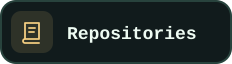
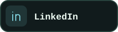
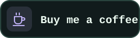
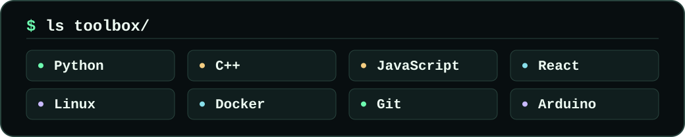

  <picture><source media="(max-width: 580px) and (prefers-color-scheme: light)" srcset="assets/terminal-profile/console-mobile-light.svg"><source media="(max-width: 580px)" srcset="assets/terminal-profile/console-mobile-dark.svg"><source media="(prefers-color-scheme: light)" srcset="assets/terminal-profile/console-light.svg"></picture>
  

  <a href="https://adam-zs-portfolio.vercel.app/"><picture><source media="(prefers-color-scheme: light)" srcset="assets/terminal-profile/portfolio-light.svg"></picture></a>
  <a href="https://github.com/Adam-ZS?tab=repositories"><picture><source media="(prefers-color-scheme: light)" srcset="assets/terminal-profile/repositories-light.svg"></picture></a>
  <a href="https://linkedin.com/in/adam-soman"><picture><source media="(prefers-color-scheme: light)" srcset="assets/terminal-profile/linkedin-light.svg"></picture></a>
  <a href="https://buymeacoffee.com/tf_a0"><picture><source media="(prefers-color-scheme: light)" srcset="assets/terminal-profile/support-light.svg"></picture></a>
  

  <!-- contribution calendar -->
  <a href="https://github.com/users/Adam-ZS/contributions">
    <picture>
      <source media="(max-width: 580px) and (prefers-color-scheme: light)" srcset="assets/terminal-profile/activity-mobile-light.svg">
      <source media="(max-width: 580px)" srcset="assets/terminal-profile/activity-mobile-dark.svg">
      <source media="(prefers-color-scheme: light)" srcset="assets/terminal-profile/activity-light.svg">
      
    </picture>
  </a>
  <!-- end contribution calendar -->
  <picture><source media="(max-width: 580px) and (prefers-color-scheme: light)" srcset="assets/terminal-profile/toolbox-mobile-light.svg"><source media="(max-width: 580px)" srcset="assets/terminal-profile/toolbox-mobile-dark.svg"><source media="(prefers-color-scheme: light)" srcset="assets/terminal-profile/toolbox-light.svg"></picture>

